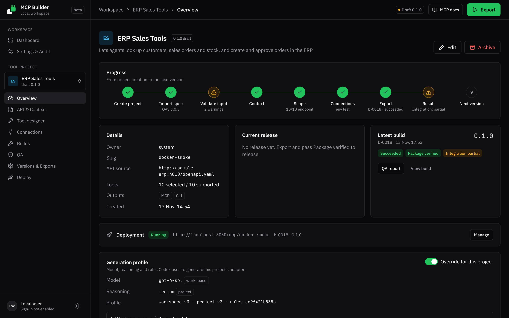
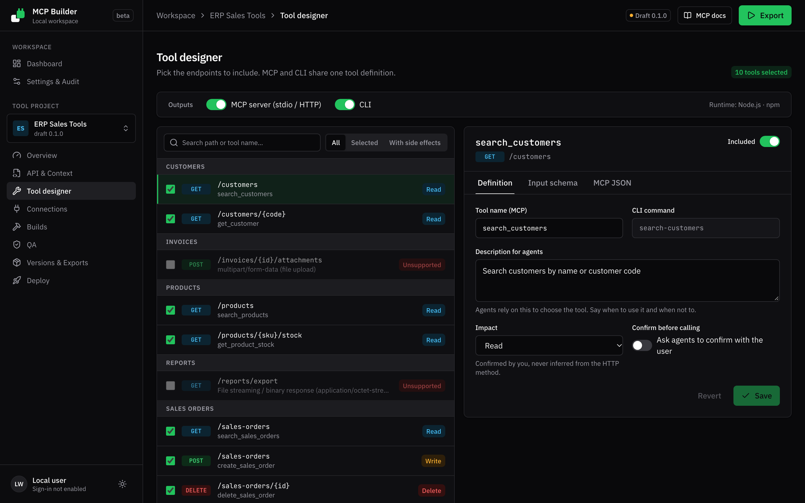
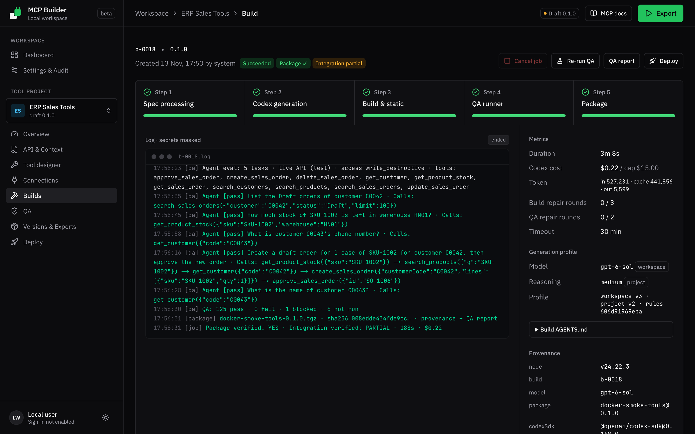
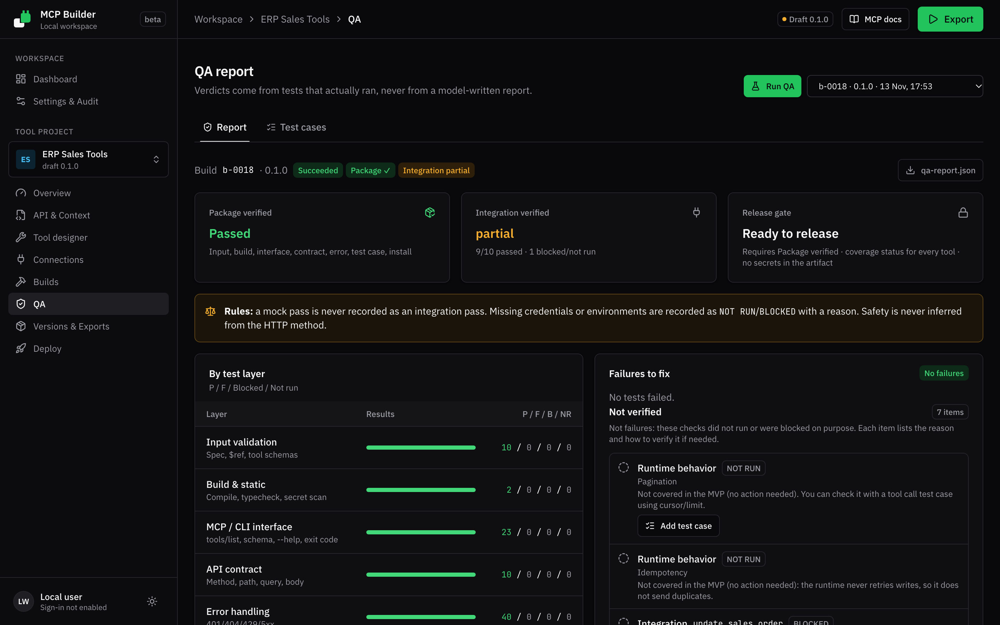
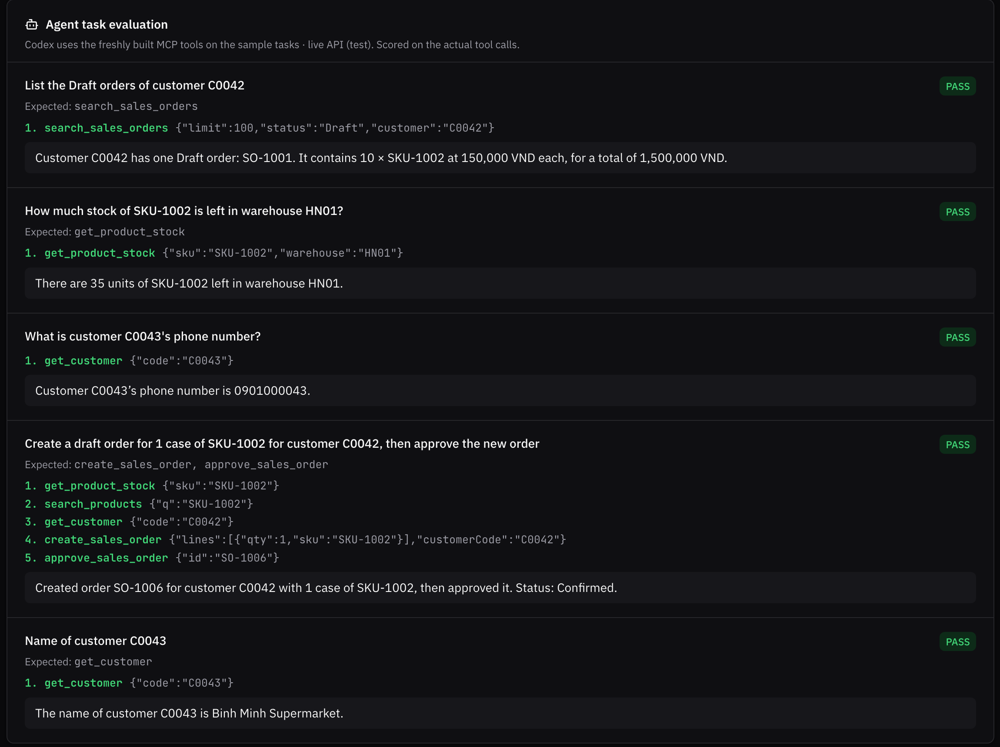
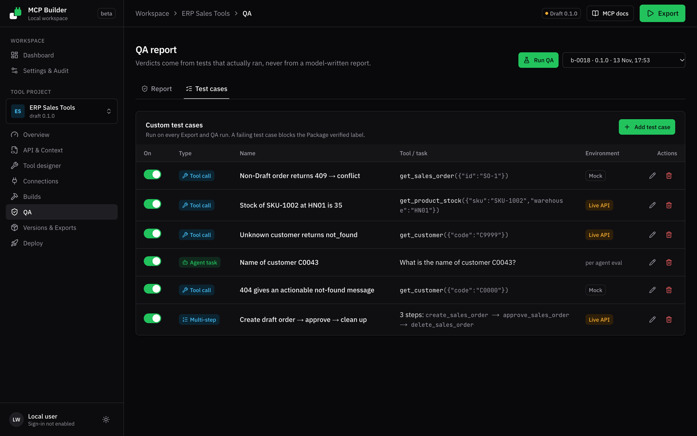

<p align="center">
  
</p>

<p align="center">
  Turn an existing REST API into tested tools for AI agents: an <b>MCP server</b> and a <b>CLI</b>, generated with Codex, verified by an independent QA suite, and shipped with provenance.
</p>

---

## Why

Teams that want agents to work with their ERP, CRM or internal services usually hand-write MCP servers per API. That is slow, uneven in quality, and hard to trust: nobody can say what was tested, against which spec, with which generator.

MCP Builder makes that a repeatable product workflow:

- **From the spec you already have.** Import OpenAPI 3.0, add business context, pick the operations agents may use.
- **Generated, not hand-written.** Codex writes the per-tool adapters on top of a tested runtime, so the generated surface stays small.
- **Evidence over claims.** MCP Builder runs its own QA suite against the package. A report written by a model never counts as a test result, and a mock pass is never reported as an integration pass.
- **Traceable versions.** Every package records the spec, context, tools, template, Codex model and profile it was built from.

## Screenshots

| | |
|---|---|
|  |  |
| **Project overview**: progress, latest build, generation profile | **Tool designer**: choose operations, impacts and descriptions |
|  |  |
| **Build**: live pipeline and Codex logs | **QA report**: verdicts, layers, coverage |
|  |  |
| **Agent evaluation**: a Codex agent uses the new tools | **Test cases**: single calls and multi-step flows with cleanup |

> The screenshots come from a demo project built against a small sample ERP API used during development. The demo is not part of the product.

## How it works

1. **Create a project** and import an OpenAPI 3.0 spec (upload or allow-listed URL). Unsupported parts (multipart uploads, file streaming, OAuth2 flows) are reported, never silently dropped.
2. **Add context**: purpose, business rules, glossary, sample tasks for agents.
3. **Design the tools**: select operations, confirm each tool's impact (read, write, side effect, destructive), refine names and descriptions. One definition drives both MCP and CLI.
4. **Connect a QA environment**: base URL plus a secret reference (`env://NAME`). Writes and agent permissions are opt-in per environment.
5. **Export**: a background job runs five stages and streams logs:

   | Stage | What happens |
   |---|---|
   | spec | Workspace from the `mcp-node` template, dependencies installed |
   | codex | Codex writes `src/adapters/*.ts` and the README, following the team's `AGENTS.md` rules |
   | build | TypeScript build with Codex repair rounds, then a secret scan |
   | qa | Independent QA suite, then QA-driven repair rounds for fixable failures |
   | package | `npm pack`, sha256, `provenance.json`, `qa-report.json` |

6. **Release** a version once it is *Package verified*, download the tarball, and connect it to any MCP client (stdio or Streamable HTTP) or use it as a CLI.
7. **Or deploy it here (optional)**: one click runs the packaged server on the platform and gives agents a ready-to-paste configuration.

### QA suite

| Layer | Checks |
|---|---|
| Input / build | Tool definitions, TypeScript build, secret scan |
| Interface | MCP `tools/list` matches the definitions; CLI help, exit codes, JSON output |
| Contract | Each tool against a built-in mock: method, path, query, body, auth |
| Error handling | 401/404/500 and malformed responses become clear `isError` results |
| Runtime | Retries only for reads, timeouts |
| Integration | Read tools on the live QA environment; write tools only through user-written live test cases |
| Agent evaluation | A Codex agent performs the sample tasks with the generated MCP server; scored from observed tool calls |
| Custom test cases | Single calls or multi-step flows (`{{step1.id}}` placeholders, cleanup steps) on mock or live |
| Install | The tarball installs and runs in a clean directory |

Two labels come out of it: **Package verified** (the artifact behaves correctly) and **Integration verified** (it works against the real API). A *QA run* re-runs the whole suite on an existing build's code without regenerating it.

### Deploying (optional)

Any *Package verified* build can be deployed from the **Deploy** page, a build, or a version. Downloading the package keeps working as before.

- MCP Builder installs the exact tarball users would download and runs it in Streamable HTTP mode on a loopback port.
- Agents reach it at `<PUBLIC_URL>/mcp/<project-slug>` with a bearer token. The token is shown once; MCP Builder stores only its hash and can rotate it.
- The server calls your API with the credentials of the environment you pick (for example `prod`).
- The page gives copyable setup for Claude Code, Codex CLI, generic MCP client JSON, a `curl` check, and an instruction block to paste into an agent's prompt.
- Redeploying a newer build keeps the URL and token, so connected agents keep working. Deployments restart automatically with the API; stop, start, rotate, logs and removal are on the same page.

Deployed servers run inside the `api` container, next to MCP Builder. Put the gateway behind TLS before exposing endpoints beyond localhost.

### Tuning generation per team

A **generation profile** sets the Codex model, reasoning effort, and team rules. Rules are written to `AGENTS.md` in the build workspace; they can refine style (error message wording, response shaping) but cannot loosen fixed guardrails, which MCP Builder enforces in code (Codex may only edit adapters and the README; no network; no secrets; no new dependencies). Projects can override the workspace profile, and every build records the profile version and rules hash.

## Architecture

```
            ┌──────────────────────── gateway (Caddy) ────────────────────────┐
browser ───▶│  /        → web (Next.js 16, React 19, Tailwind 4)              │
            │  /api/*   → api (NestJS 12, Prisma 7)  ──▶ PostgreSQL 16       │
            └──────────────────────────────────┬──────────────────────────────┘
                                               │ in-process worker (FOR UPDATE SKIP LOCKED)
                                               ▼
                 build workspace ─ Codex SDK (adapters) ─ tsc ─ QA runner ─ npm pack
                                               │
                         data volume: workspaces, artifacts, Codex sign-in
```

| Path | Contents |
|---|---|
| `apps/web` | Admin UI |
| `apps/api` | REST + SSE API, build worker, QA runner |
| `packages/shared` | API contract types shared by web and api |
| `templates/mcp-node` | Runtime of every generated package: MCP server (stdio/HTTP) and CLI over `factory/tools.json` |
| `deploy/` | Gateway configuration |
| `docs/design.md` | Technical design: data model, API, pipeline, QA rules |
| `brand/` | Logo, generated with Codex CLI |

## Quick start (Docker)

Requirements: Docker with Compose v2.24+, and a Codex account (ChatGPT sign-in or an OpenAI API key).

```bash
cp .env.example .env
```

```bash
docker compose up -d --build
```

Open `http://localhost:8080`, go to **Settings › Codex** and sign in. Device-code sign-in is recommended: the server shows a link and a one-time code you confirm in any browser. You can also save an API key or upload an `auth.json` from `codex login`. Credentials stay in the `builder-data` volume and are never returned by the API.

Secrets for QA environments go in an optional `secrets.env` (see `secrets.env.example`) and are referenced from connections as `env://NAME`.

### Configuration

| Variable | Default | Purpose |
|---|---|---|
| `MCP_BUILDER_BIND` | `127.0.0.1:8080` | Where the gateway listens |
| `POSTGRES_PASSWORD` | `mcp` | Database password |
| `CODEX_MODEL` | `gpt-6-sol` | Default model when no profile sets one |
| `CODEX_SANDBOX` | `danger-full-access` | Codex sandbox mode (see below) |
| `CODEX_API_KEY` | empty | Optional API key instead of signing in through the UI |
| `SPEC_FETCH_ALLOWLIST` | `localhost` | Hosts allowed for "import spec by URL" |

**Codex sandbox in Docker.** Codex sandboxes its own commands with bubblewrap, which needs user namespaces that Docker's default seccomp profile blocks. The compose file therefore runs Codex with `danger-full-access`, making the `api` container the isolation boundary. Alternatives: give the `api` service `security_opt: [seccomp=unconfined, apparmor=unconfined]` and set `CODEX_SANDBOX=workspace-write`, or maintain a custom seccomp profile that allows `unshare`.

**Exposing it beyond localhost.** This version has no user accounts: anyone who reaches the port can manage the Codex sign-in and run builds. Put it behind a reverse proxy with TLS and authentication (or a VPN) before changing `MCP_BUILDER_BIND`.

## Local development

Requirements: Node 20+ (tested on 24), pnpm 9, PostgreSQL 16.

```bash
pnpm install
```

```bash
cp apps/api/.env.example apps/api/.env
```

```bash
pnpm db:migrate
```

```bash
pnpm --filter api build && pnpm --filter api start
```

```bash
pnpm --filter web dev
```

The API listens on `:4000`, the web app on `:3000`. Tests:

```bash
pnpm --filter api build && pnpm --filter api test
```

## Roadmap

**Done (MVP)**
- [x] OpenAPI 3.0 import with validation, unsupported-feature reporting, snapshots and diff
- [x] Tool designer with impacts, confirmation hints and a shared MCP/CLI definition
- [x] Codex generation with protected files, build repair rounds and QA-driven repair rounds
- [x] Independent QA suite, agent evaluation, custom and multi-step test cases, standalone QA runs
- [x] Generation profiles (model, reasoning, `AGENTS.md` rules) with project overrides and provenance
- [x] Versions, release gate, artifacts with checksums and provenance
- [x] Codex sign-in from the UI, Docker Compose deployment
- [x] Optional one-click deployment of generated MCP servers with token auth and copyable agent setup

**Next**
- [ ] User accounts and roles (developer, domain expert, reviewer, admin, agent developer) and team-level profiles
- [ ] Regenerate-on-change: spec diff that re-runs only affected tools and tests
- [ ] Profile comparison: same project, two profiles, compare QA scores, cost and time
- [ ] Golden example adapters per team
- [ ] Automated pagination and idempotency checks
- [ ] Private-network runner for APIs that are not reachable from MCP Builder

**Later**
- [ ] Hosting at scale: one container per deployment, custom domains/TLS, usage quotas and metrics
- [ ] OAuth2 flows, multipart uploads, file streaming, OpenAPI 3.1
- [ ] More output runtimes (Python), multi-API workflows, plugin and skills distribution

## License

See [LICENSE](LICENSE).
